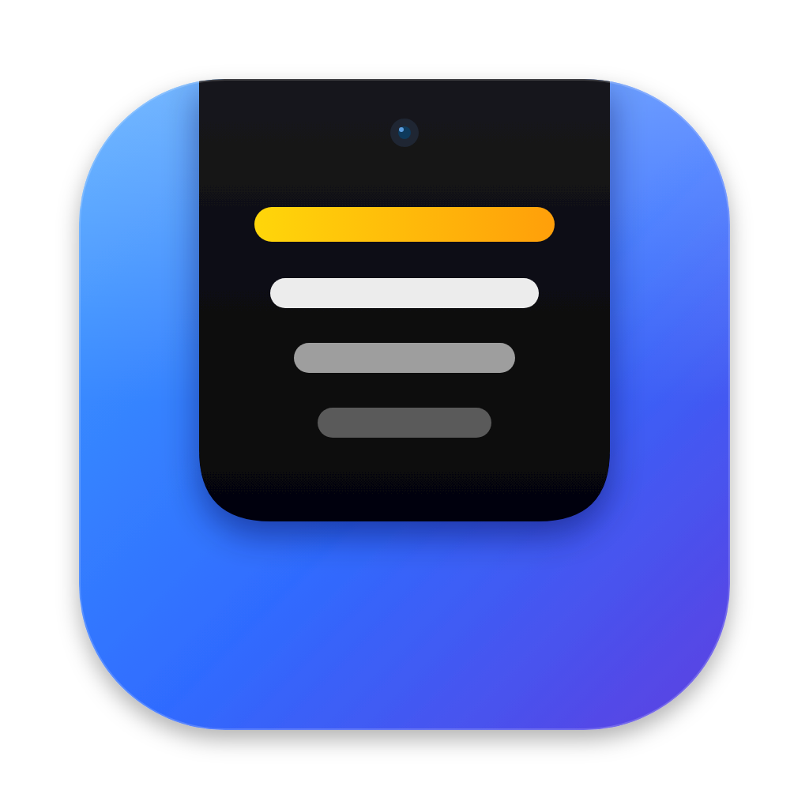

<p align="center"></p>

# Cue 🎤

A tiny macOS menu-bar teleprompter that **grows out of your MacBook Pro's notch**, so your script sits right next to the camera during Zoom / Meet / Teams calls, interviews and recordings. You keep eye contact while you read.

```
 ┌──────────────────────── menu bar ────────────────────────┐
             ╭──────────── ● camera ────────────╮
             │  …and that's why I'm excited     │
             │  about this role, because…       │
             ╰──────────────────────────────────╯
```

## Features

- Black panel that looks like the notch extending down, with your text right under the camera
- Smooth auto-scroll with adjustable speed; stops at the end
- **Hidden from screen sharing and recordings** (on by default, toggle in settings)
- Global shortcuts that work while Zoom has focus (no Accessibility permission needed)
- Scroll with the trackpad on the prompter to scrub; hover for on-screen controls
- Load `.txt`, `.md`, `.rtf`, `.docx` or `.html`, or paste your transcript
- Word count and estimated speaking time
- Text size, width, height, background opacity, mirror mode
- Works on Macs without a notch too (hangs just under the menu bar)
- Everything is saved between launches

## Shortcuts

| Shortcut | Action |
|---|---|
| `⌃⌥Space` | Play / pause |
| `⌃⌥=` / `⌃⌥-` | Faster / slower |
| `⌃⌥[` / `⌃⌥]` | Jump back / forward 3 lines |
| `⌃⌥R` | Restart from the top |
| `⌃⌥T` | Show / hide the teleprompter |

(`⌃` = Control, `⌥` = Option)

## Build & run

You need macOS 13 or later and the Swift toolchain. Either Xcode or just the Command Line Tools works (`xcode-select --install`).

```bash
cd Cue
./build-app.sh            # builds build/Cue.app
open build/Cue.app

# or build and copy to /Applications in one go
./build-app.sh --install
```

For quick development runs: `swift run`

You can also open the folder in Xcode (`open Package.swift`) and press ▶︎.

> The first time you open an ad-hoc-signed app, macOS may block it. Right-click the app, choose **Open**, then confirm.

## Use it in a call

1. Click the menu-bar icon and choose **Edit Script…**. Paste your transcript or open a file.
2. Set the text size and speed. About 25–40 pt/s is a comfortable speaking pace.
3. Join your call, press `⌃⌥Space` and talk.
4. Before an important call, **do a test screen share** to confirm the prompter doesn't show for others.

## A note on "hidden from screen sharing"

The panel uses `NSWindow.sharingType = .none`, which hides it from most screen-sharing and recording tools. Whether it stays hidden depends on the app and the macOS version, because some newer capture paths ignore this flag. Always check with a test share (Zoom: *Share Screen → Desktop*, then look at the preview) before relying on it.

## Project layout

```
Cue/
├── Package.swift
├── build-app.sh              # builds a proper .app bundle
├── Resources/
│   ├── Info.plist            # LSUIElement = menu-bar app
│   ├── AppIcon.svg           # icon source
│   └── AppIcon.png           # 1024px icon (build turns it into .icns)
└── Sources/Cue/
    ├── main.swift
    ├── AppDelegate.swift     # menu-bar item, hotkeys, editor window
    ├── NotchPanel.swift      # notch-positioned floating panel
    ├── PrompterView.swift    # scrolling text + hover controls
    ├── EditorView.swift      # script editor & settings
    ├── PrompterState.swift   # playback + persisted settings
    └── HotKeys.swift         # global shortcuts (Carbon)
```
